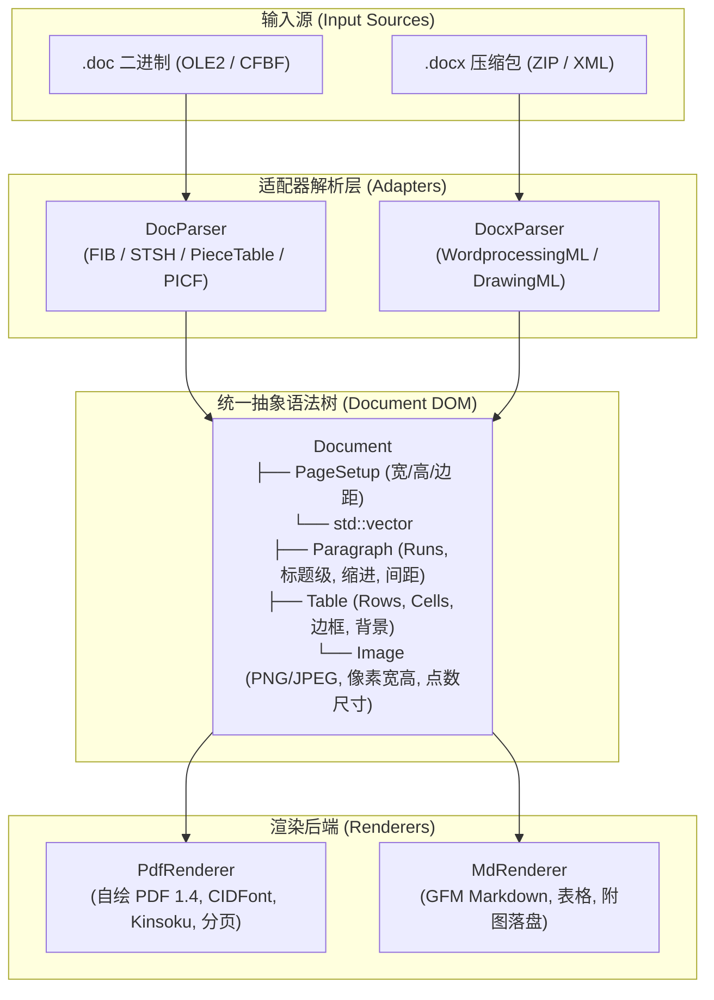

# PureDoc2Pdf / PureDoc2Md 架构与技术规范

纯 C++11 源码实现的跨架构（x86_64 / aarch64 / mips64el / loongarch64）文档转译排版引擎。
零外部进程调用，零预编译 Office 依赖。

---

## 1. 架构设计 (Adapter Pattern)



---

## 2. DOC 图片定位与尺寸判定原理

在 Microsoft Word `.doc` 二进制规范中：
1. **正文流标记**:
   - 行内嵌入图片在正文字符流中以 `0x01` (`\x01`) 占位。
2. **字符格式 (CHPX) 寻址**:
   - `PlcfbteChpx` 存储该字符的属性块，包含 `sprmCPicLocation` (Opcode: `0x6A03`)。
   - 其参数为 32 位整数 `fcPic`，指示图片在 `/Data` 流中的物理偏移量。
3. **PICF 描述符计算真实显示尺寸**:
   - 在 `fcPic` 处解析 68 字节的 `PICF` 结构：
     - `dxaGoal` (offset 28): 原始宽度 (twips, 1 pt = 20 twips)
     - `dyaGoal` (offset 30): 原始高度 (twips)
     - `mx` (offset 32): 水平缩放因子 (千分比，1000 = 100%)
     - `my` (offset 34): 垂直缩放因子 (千分比)
   - 目标显示点数 (pt)：
     $$\text{Width (pt)} = \frac{\text{dxaGoal} \times \text{mx}}{20 \times 1000},\quad \text{Height (pt)} = \frac{\text{dyaGoal} \times \text{my}}{20 \times 1000}$$

---

## 3. 命令行用法

```bash
# 构建
mkdir -p build && cd build
cmake .. && make

# 运行自动化测试 (41 项断言)
ctest --output-on-failure

# 1. 转 PDF (自动适配 doc / docx)
./pure_doc2pdf ../testdata/risk_report_8083890e.doc output.pdf

# 2. 导出 Markdown (自动导出 GFM 表格与本地图片目录)
./pure_doc2pdf ../testdata/risk_report_8083890e.doc output.md
```
